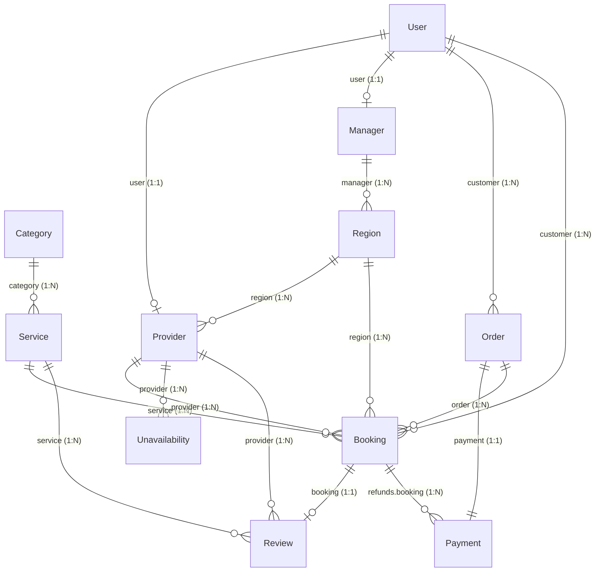
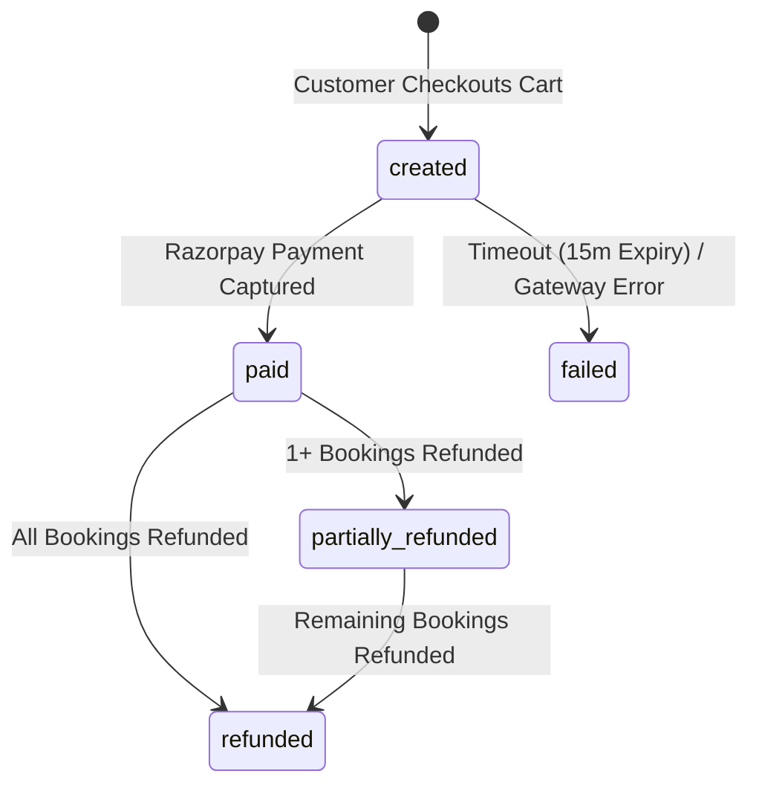
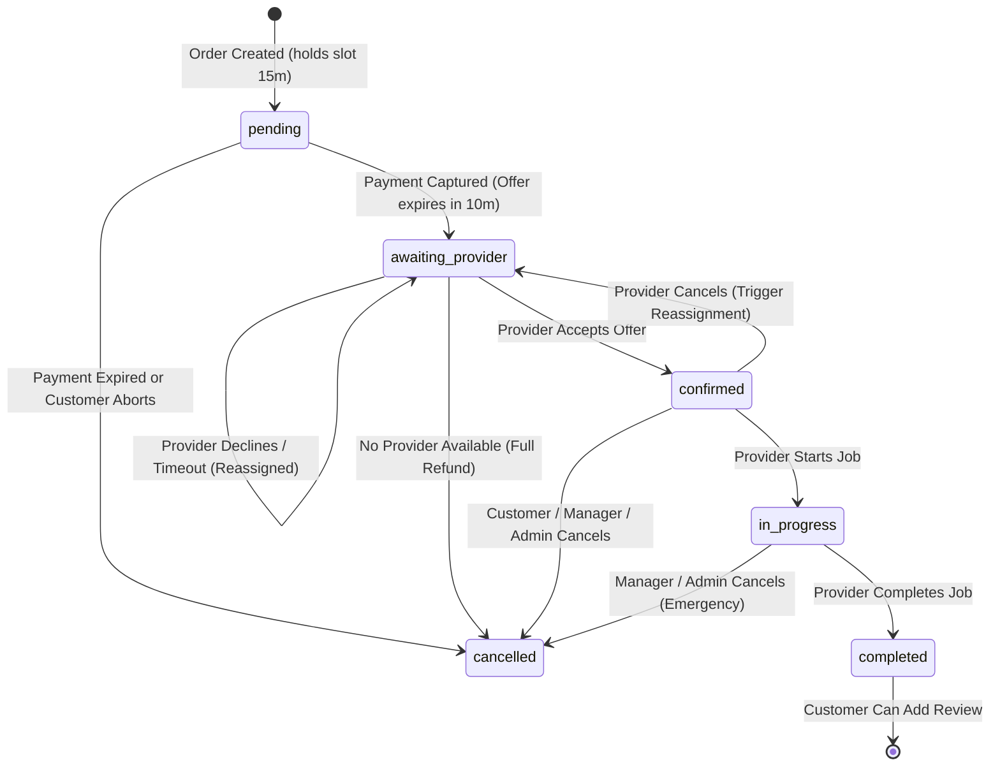

# Cross-Collection Architecture & Implementation Guide

This guide documents the cross-collection schema relationships, business integrity rules, state machines, and REST controller/service implementations across the Tatku United backend. It directly bridges the physical data model defined in [`schema.txt`](../database/schema.txt) and the operational rules defined in [`db_docs.md`](../database/db_docs.md).

---

## 1. Domain Architecture & Reference Blueprint

The platform manages on-demand home and digital services. All human participants have a single root `User` record; specialized roles (`provider`, `manager`) have secondary profile documents that reference `User` through `user`. Customer checkouts snapshot service prices and customer addresses onto `Order` and `Booking` documents to preserve historical integrity.

---

## 2. Cross-Collection References Matrix

| Source Collection | Field | Target Collection | Cardinality | Purpose & Integrity Rule |
| :--- | :--- | :--- | :--- | :--- |
| **Provider** | `user` | **User** | 1:1 (`unique`) | Points to the base user account (`role: provider`). Omits password in populates. |
| **Provider** | `offeredServices[]` | **Service** | N:M (Array) | Catalog offerings the provider can fulfill. Drives slot candidate assignment. |
| **Provider** | `region` | **Region** | N:1 | Management grouping. Used by regional managers to review applications. |
| **Manager** | `user` | **User** | 1:1 (`unique`) | Points to the base user account (`role: manager`). |
| **Region** | `manager` | **Manager** | N:1 | The regional manager assigned to oversee providers and jobs in this territory. |
| **Service** | `category` | **Category** | N:1 | Service taxonomy and catalog group. |
| **Order** | `customer` | **User** | N:1 | The customer who initiated the checkout. |
| **Order** | `payment` | **Payment** | 1:1 | The payment transaction record created for gateway checkout. |
| **Booking** | `order` | **Order** | N:1 | Parent order for this booking item. Contains address snapshot. |
| **Booking** | `customer` | **User** | N:1 | The customer receiving the service. |
| **Booking** | `service` | **Service** | N:1 | The catalog service item booked. Price is snapshotted at creation. |
| **Booking** | `provider` | **Provider** | N:1 | Assigned provider (tentative during creation, final upon acceptance). |
| **Booking** | `region` | **Region** | N:1 | Operational region where the job takes place. |
| **Booking** | `declinedBy[]` | **Provider** | N:M (Array) | Providers who declined, timed out, or cancelled. Never offered this job again. |
| **Payment** | `order` | **Order** | 1:1 (`unique`) | Gateway record corresponding to parent checkout order. |
| **Payment** | `refunds[].booking` | **Booking** | N:1 | Specific booking item refunded through Razorpay API. |
| **Review** | `booking` | **Booking** | 1:1 (`unique`) | Verified review submitted by the customer for a completed booking. |
| **Review** | `provider` | **Provider** | N:1 | Denormalized reference to allow fast provider rating calculations. |
| **Review** | `service` | **Service** | N:1 | Denormalized reference to allow fast service rating calculations. |
| **Unavailability**| `provider` | **Provider** | N:1 | Blackout periods on the provider's calendar. |
| **User (Embedded)**| `cart.items[].service`| **Service**| N:1 | Service chosen in customer shopping cart. |

---

## 3. Domain State Machines & Workflows

### 3.1 Order Payment Status
Defined in [`schema.txt`](../database/schema.txt) and [`db_docs.md`](../database/db_docs.md) §5:

### 3.2 Booking Status & Provider Reassignment
Slot-holding statuses (`pending`, `awaiting_provider`, `confirmed`, `in_progress`) prevent overlapping bookings on the provider's slot grid:

---

## 4. Implementation Details by Domain Module

### 4.1 Orders Module
- **`GET /orders/customer/:customerId`**: Retrieves all orders for a customer sorted by creation date descending.
- **`GET /orders/status/:status`**: Allows filtering orders by lifecycle state (`created`, `paid`, `failed`, `refunded`, `partially_refunded`).
- **`GET /orders/:id/details`**: Populates `customer` (excluding password) and `payment` references for full checkout visibility.
- **Controller**: [`OrdersController`](file:///c:/Home/College/FSD/20_TatkuUnited/back-end/src/orders/orders.controller.ts)
- **Service**: [`OrdersService`](file:///c:/Home/College/FSD/20_TatkuUnited/back-end/src/orders/orders.service.ts)

### 4.2 Bookings Module
Implements provider offer dispatch, schedule monitoring, problem reporting, and lifecycle transitions:
- **`GET /bookings/customer/:customerId`**: Customer's service booking history.
- **`GET /bookings/provider/:providerId`**: All bookings scheduled for a provider.
- **`GET /bookings/order/:orderId`**: All individual bookings created from a multi-item checkout order.
- **`GET /bookings/region/:regionId?date=YYYY-MM-DD`**: All scheduled bookings in an operational region.
- **`GET /bookings/provider/:providerId/offers`**: Provider's pending offer inbox (`status: awaiting_provider` and `offerExpiresAt > now`).
- **`GET /bookings/provider/:providerId/schedule?date=YYYY-MM-DD`**: Provider's upcoming/active jobs (`confirmed`, `in_progress`).
- **`GET /bookings/region/:regionId/problems`**: Regional manager alert dashboard displaying jobs cancelled by providers or the system (`cancelledBy: provider | system`).
- **`POST /bookings/:id/accept`**: Provider accepts a job offer before timeout, transitioning it to `confirmed` and clearing `offerExpiresAt`.
- **`POST /bookings/:id/reject`**: Provider declines a job offer, adding them to `declinedBy` to trigger reassignment.
- **`POST /bookings/:id/start`**: Provider transitions `confirmed` booking to `in_progress`.
- **`POST /bookings/:id/complete`**: Provider transitions `in_progress` booking to `completed`.
- **`POST /bookings/:id/cancel`**: Handles cancellation with `cancelledBy` (`customer`, `provider`, `manager`, `admin`, `system`) and reason.
- **Controller**: [`BookingsController`](file:///c:/Home/College/FSD/20_TatkuUnited/back-end/src/bookings/bookings.controller.ts)
- **Service**: [`BookingsService`](file:///c:/Home/College/FSD/20_TatkuUnited/back-end/src/bookings/bookings.service.ts)

### 4.3 Regions Module
- **`GET /regions/manager/:managerId`**: Resolves operational regions controlled by a manager. Seamlessly handles both the `Manager` document `_id` and the manager's `User` account `_id`.
- **`POST /regions/:id/recompute-centroid`**: Recomputes the region centroid (`location: { type: "Point", coordinates: [lng, lat] }`) as the mean coordinates of all approved providers in that region ([`db_docs.md`](../database/db_docs.md) §4.2 Step 5).
- **Controller**: [`RegionsController`](file:///c:/Home/College/FSD/20_TatkuUnited/back-end/src/regions/regions.controller.ts)
- **Service**: [`RegionsService`](file:///c:/Home/College/FSD/20_TatkuUnited/back-end/src/regions/regions.service.ts)

### 4.4 Providers Module
- **`GET /providers/user/:userId`**: Retrieves provider profile linked to a user account.
- **`GET /providers/region/:regionId?status=pending`**: Regional managers filter providers in their jurisdiction by status (`pending`, `approved`, `suspended`).
- **`GET /providers/status/:status`**: Platform-wide provider filtering by status.
- **`GET /providers/service/:serviceId`**: Finds active providers capable of performing a specific catalog service.
- **`PATCH /providers/:id/approve`**: Regional manager or admin approves a provider profile.
- **`PATCH /providers/:id/suspend`**: Regional manager or admin suspends a provider account.
- **Controller**: [`ProvidersController`](file:///c:/Home/College/FSD/20_TatkuUnited/back-end/src/providers/providers.controller.ts)
- **Service**: [`ProvidersService`](file:///c:/Home/College/FSD/20_TatkuUnited/back-end/src/providers/providers.service.ts)

### 4.5 Users Module (Addresses & Cart)
According to [`schema.txt`](../database/schema.txt) and [`db_docs.md`](../database/db_docs.md) §4.3 & §4.5, customer addresses and shopping carts are embedded directly inside the `User` document:
- **`GET /users/:id/addresses`**: Retrieves all saved addresses with GeoJSON points.
- **`POST /users/:id/addresses`**: Appends a new saved delivery address with auto-generated ID.
- **`DELETE /users/:id/addresses/:addressId`**: Removes a saved delivery address.
- **`GET /users/:id/cart`**: Retrieves shopping cart populated with catalog `Service` details.
- **`POST /users/:id/cart`**: Pushes an item reservation slot (`service`, `scheduledDate`, `startTime`, `endTime`) into cart.
- **`DELETE /users/:id/cart/:index`**: Removes an item from the cart by index.
- **`DELETE /users/:id/cart`**: Clears all cart items upon checkout or cancellation.
- **`PATCH /users/:id/cart/address`**: Selects a delivery address for checkout.
- **`GET /users/me`**: Current authenticated user profile lookup.
- **`GET /users/role/:role`**: Admin lookup for users filtered by role (`customer`, `provider`, `manager`, `admin`).
- **Controller**: [`UsersController`](file:///c:/Home/College/FSD/20_TatkuUnited/back-end/src/users/users.controller.ts)
- **Service**: [`UsersService`](file:///c:/Home/College/FSD/20_TatkuUnited/back-end/src/users/users.service.ts)

### 4.6 Reviews Module (Atomic Running Average Calculation)
According to [`db_docs.md`](../database/db_docs.md) §4.13, when a customer submits a review for a completed booking:
$$\text{newRating} = \frac{\text{rating} \times \text{ratingCount} + \text{new}}{\text{ratingCount} + 1}$$
- Upon calling `POST /reviews`, `ReviewsService` automatically and atomically recalculates the running rating and increments `ratingCount` / `reviewCount` on both the associated **Provider** and **Service** documents.
- **`GET /reviews/service/:serviceId`**: Public customer reviews for a catalog item.
- **`GET /reviews/provider/:providerId`**: Public customer reviews for a provider.
- **`GET /reviews/booking/:bookingId`**: Specific review record for a booking.
- **Controller**: [`ReviewsController`](file:///c:/Home/College/FSD/20_TatkuUnited/back-end/src/reviews/reviews.controller.ts)
- **Service**: [`ReviewsService`](file:///c:/Home/College/FSD/20_TatkuUnited/back-end/src/reviews/reviews.service.ts)

### 4.7 Unavailability & Payments Module
- **`GET /unavailability/provider/:providerId?date=YYYY-MM-DD`**: Retrieves provider blackout windows on the slot grid. Handles provider document `_id` or user account `_id`.
- **`GET /payments/order/:orderId`**: Retrieves transaction record and refund history by parent order ID.
- **Controllers**: [`UnavailabilityController`](file:///c:/Home/College/FSD/20_TatkuUnited/back-end/src/unavailability/unavailability.controller.ts) | [`PaymentsController`](file:///c:/Home/College/FSD/20_TatkuUnited/back-end/src/payments/payments.controller.ts)

---

## 5. Complete REST API Endpoints Catalog

| Domain | HTTP Method | Path | Roles Allowed | Description |
| :--- | :--- | :--- | :--- | :--- |
| **Orders** | `GET` | `/orders/customer/:customerId` | `customer`, `manager`, `admin` | Order history for a specific customer |
| **Orders** | `GET` | `/orders/status/:status` | `manager`, `admin` | Orders filtered by payment status |
| **Orders** | `GET` | `/orders/:id/details` | `customer`, `manager`, `admin` | Order populated with customer and payment |
| **Bookings**| `GET` | `/bookings/customer/:customerId` | `customer`, `manager`, `admin` | Booking history for a customer |
| **Bookings**| `GET` | `/bookings/provider/:providerId` | `provider`, `manager`, `admin` | Bookings scheduled for a provider |
| **Bookings**| `GET` | `/bookings/order/:orderId` | `customer`, `manager`, `admin` | All booking items under an order |
| **Bookings**| `GET` | `/bookings/region/:regionId` | `manager`, `admin` | All jobs in a region (optional date filter) |
| **Bookings**| `GET` | `/bookings/provider/:providerId/offers` | `provider`, `manager`, `admin` | Provider pending job offers inbox |
| **Bookings**| `GET` | `/bookings/provider/:providerId/schedule`| `provider`, `manager`, `admin` | Provider confirmed & in-progress schedule |
| **Bookings**| `GET` | `/bookings/region/:regionId/problems` | `manager`, `admin` | Cancelled / unfulfilled jobs in region |
| **Bookings**| `POST`| `/bookings/:id/accept` | `provider`, `admin` | Provider accepts awaiting job offer |
| **Bookings**| `POST`| `/bookings/:id/reject` | `provider`, `admin` | Provider declines offer (triggers reassignment)|
| **Bookings**| `POST`| `/bookings/:id/start` | `provider`, `manager`, `admin` | Provider marks booking in progress |
| **Bookings**| `POST`| `/bookings/:id/complete` | `provider`, `manager`, `admin` | Provider marks booking completed |
| **Bookings**| `POST`| `/bookings/:id/cancel` | `customer`, `provider`, `manager`, `admin` | Cancels booking with actor & reason |
| **Regions** | `GET` | `/regions/manager/:managerId` | `manager`, `admin` | Regions assigned to a manager |
| **Regions** | `POST`| `/regions/:id/recompute-centroid`| `manager`, `admin` | Recalculates centroid from approved providers |
| **Providers**|`GET` | `/providers/user/:userId` | `provider`, `manager`, `admin` | Provider profile by user account ID |
| **Providers**|`GET` | `/providers/region/:regionId` | `manager`, `admin` | Providers in region (optional status filter)|
| **Providers**|`GET` | `/providers/status/:status` | `manager`, `admin` | Providers filtered by status |
| **Providers**|`GET` | `/providers/service/:serviceId` | `customer`, `provider`, `manager`, `admin` | Providers offering a specific service |
| **Providers**|`PATCH`| `/providers/:id/approve` | `manager`, `admin` | Approves a provider application |
| **Providers**|`PATCH`| `/providers/:id/suspend` | `manager`, `admin` | Suspends a provider account |
| **Users** | `GET` | `/users/me` | Authenticated users | Current user session profile document |
| **Users** | `GET` | `/users/role/:role` | `admin` | User list filtered by role |
| **Users** | `GET` | `/users/:id/addresses` | Authenticated users (self/admin)| Saved customer delivery addresses |
| **Users** | `POST`| `/users/:id/addresses` | Authenticated users (self/admin)| Adds a new delivery address |
| **Users** | `DELETE`|`/users/:id/addresses/:addressId`| Authenticated users (self/admin)| Removes a delivery address |
| **Users** | `GET` | `/users/:id/cart` | Authenticated users (self/admin)| Shopping cart items & selected address |
| **Users** | `POST`| `/users/:id/cart` | Authenticated users (self/admin)| Adds a reservation item to cart |
| **Users** | `DELETE`|`/users/:id/cart/:index` | Authenticated users (self/admin)| Removes item from cart by index |
| **Users** | `DELETE`|`/users/:id/cart` | Authenticated users (self/admin)| Clears user cart |
| **Users** | `PATCH`| `/users/:id/cart/address` | Authenticated users (self/admin)| Selects address for cart checkout |
| **Reviews** | `POST`| `/reviews` | `customer`, `admin` | Submits review & updates running ratings |
| **Reviews** | `GET` | `/reviews/service/:serviceId` | Public | All reviews for a catalog service |
| **Reviews** | `GET` | `/reviews/provider/:providerId` | Public | All reviews for a service provider |
| **Reviews** | `GET` | `/reviews/booking/:bookingId` | Authenticated users | Review record for a booking |
| **Unavail.**| `GET` | `/unavailability/provider/:providerId`| `provider`, `manager`, `admin` | Provider blackout time slots |
| **Payments**| `GET` | `/payments/order/:orderId` | `customer`, `manager`, `admin` | Payment transaction by parent order |
| **Services**| `GET` | `/services/category/:categoryId` | Public | Services grouped by category |
